# ProCaller User Manual

**AP Infotech and Cyber Solution**

Open the picture manual in a browser: [docs/manual/index.html](manual/index.html). The same screens are below. They were taken from the live app on 15 October 2026, signed in as Super Admin.

Manual dialing, campaigns, and inbound calls on one agent phone.

## 1. Sign in

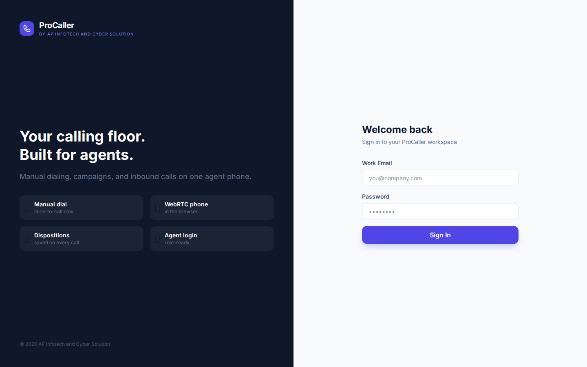

1. Open ProCaller in the browser.
2. Enter the work email and password created for you, then choose **Sign In**.
3. Allow the microphone. The dialer uses the headset in this browser.

Each person sees only their own agency. A user sees the campaigns assigned to them.

## 2. Who does what

| Role | What they do |
|------|----------------|
| Super Admin | Creates agencies, sets seat limits, and turns IVR voice campaigns on for an agency. Sees every agency. |
| Agency | Runs one company. Creates managers, admins, and users on that line. Uploads leads, sets threads, sees calls, and can log a lower user out. |
| Manager | Creates admins and users under their team. Manages campaigns, lead files, and reports for that team. |
| Admin | Creates and edits campaigns, uploads lead files, and works reports. An admin does not create user accounts. |
| User | Manual calls and Preview Auto on assigned campaigns. A user cannot change thread counts, and cannot turn lead files off or delete leads. |

A PC number and an extension are attached once, when the account is created, and they stay with that person.

## 3. The menu

Working screens: Dashboard, Live Operations, Dialer, Contacts, Leads, Campaigns, Calls, Recordings, Team, Reports, and Agencies (Super Admin).

The hourly chart on the Dashboard, the Analytics page, Call Queue, and Follow-ups still draw sample pictures. Live figures are the count cards, Live Operations, Calls, Recordings, Leads, and Reports.

## 4. Dashboard

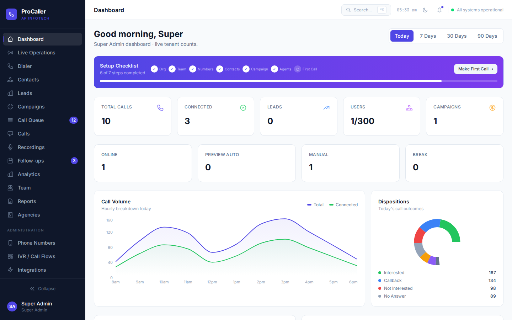

The count cards are live for today: calls, connected calls, leads, users against the seat limit, campaigns, and people online, in Preview Auto, in Manual, or on Break. The chart and ring under the cards are sample artwork. **Make First Call** opens the dialer.

## 5. Live Operations

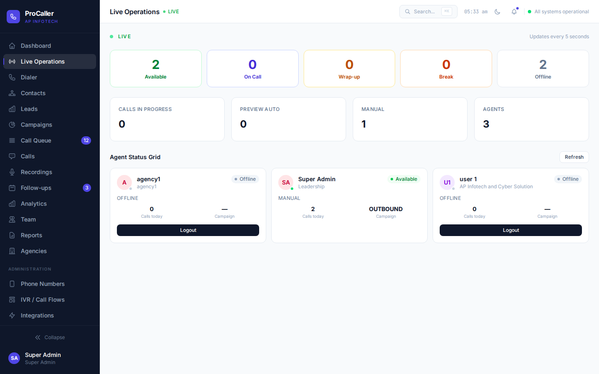

Available, On Call, Wrap-up, Break, and Offline refresh about every 5 seconds. **Logout** ends that person’s session. An agency sees its own line.

## 6. Dialer

### Manual

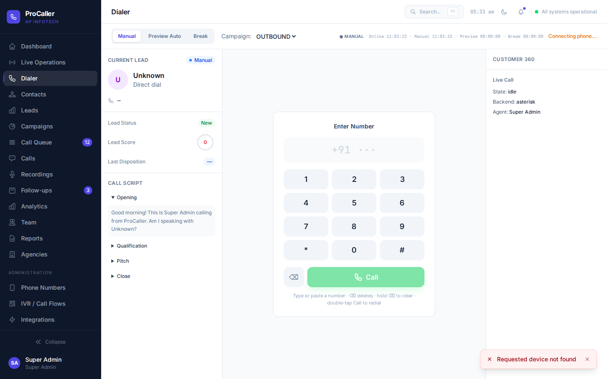

1. Choose **Manual** and the campaign.
2. Type the number. The prefix +91 is already shown.
3. Press **Call**.

The screen stays on Ringing until the customer’s phone is answered, then it shows Connected. An inbound call rings the computer and offers **Answer** or **Hang up**.

### Preview Auto

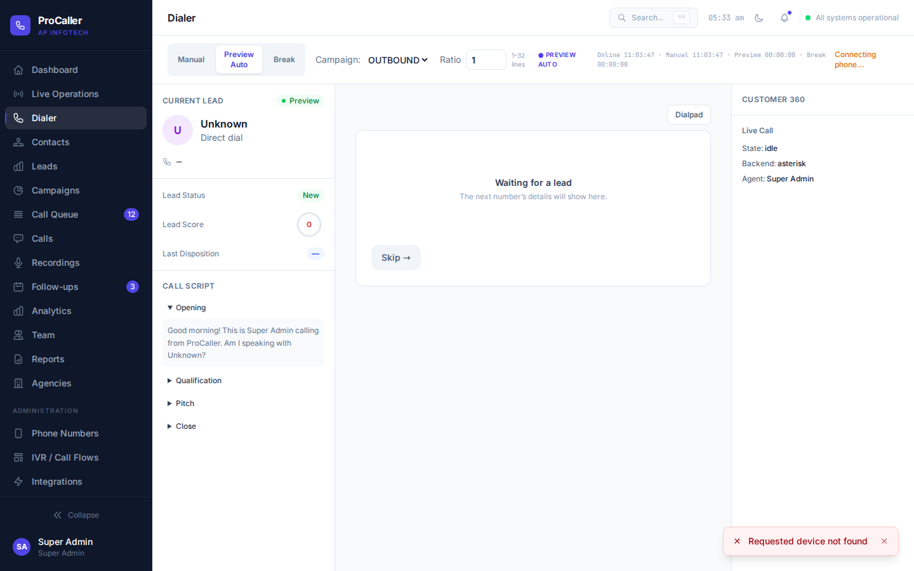

1. Choose **Preview Auto** and the campaign.
2. The lead’s details fill the center. **Dialpad** opens the keypad. **Hide dialpad** returns to the lead.
3. **Skip** moves on. **Break** pauses auto dialing.

The thread count belongs to the campaign. It is how many Preview Auto users can be on a live call for that campaign at the same time. A user cannot change it. Staff who can edit the campaign set it on the campaign card, from 1 to 32.

## 7. Campaigns

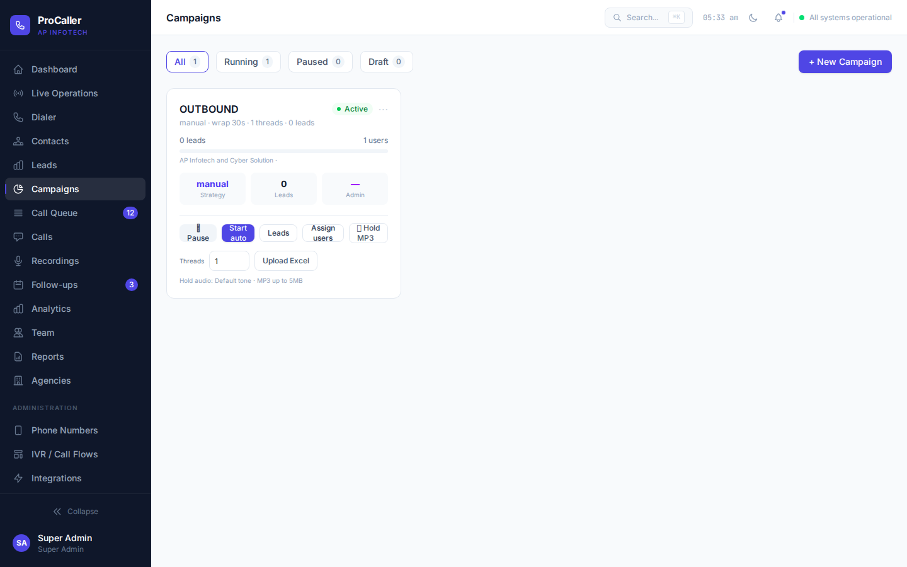

1. **New Campaign**.
2. Set **Threads** (1–32).
3. **Assign users**.
4. **Upload Excel**. A mobile column is required. Every other column is stored on the lead. One mobile number is one lead inside a campaign.
5. **Start auto** lets seated Preview Auto users take leads, one live call each, up to the thread count.
6. **Pause** stops new auto calls. **Hold MP3** is the hold audio, up to 5 MB.

## 8. Leads and contacts

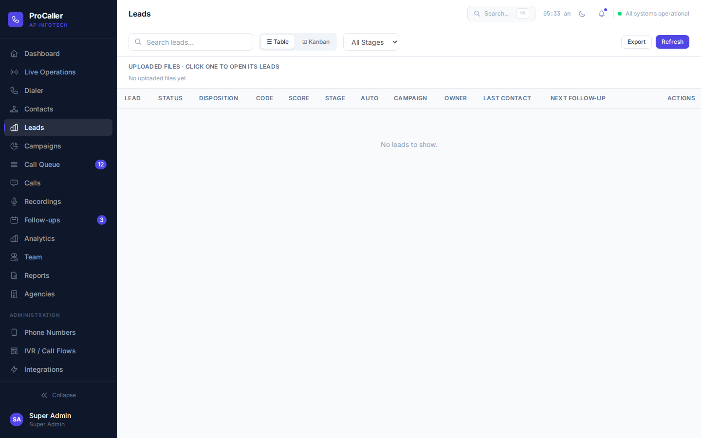

- Super Admin sees every agency. Agency, manager, and admin see their own agency. A user sees owned leads and leads on assigned campaigns.
- Click an uploaded file to open its leads. A lead that has never been dialed shows **Not dialed**.
- **Deactivate** makes Preview Auto skip that file. Each lead also has Off / On.
- **Delete** removes the lead and keeps call history. Deleting a file removes its name once no lead from it is left on a live call.
- A user cannot deactivate or delete leads.

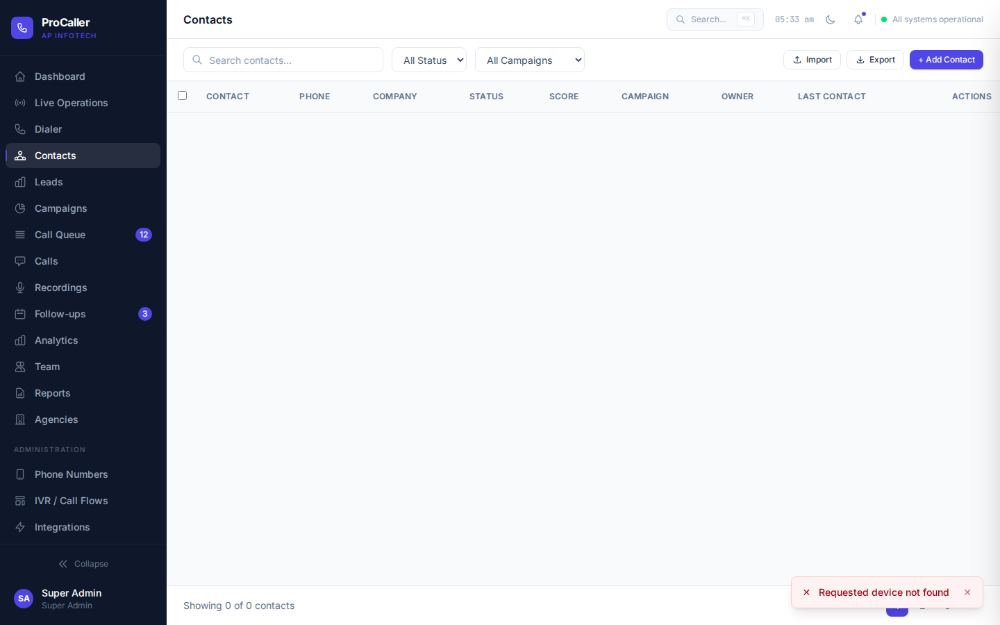

## 9. Calls and recordings

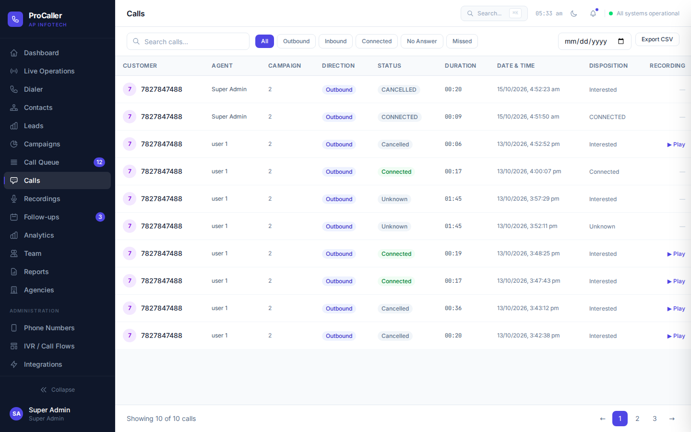

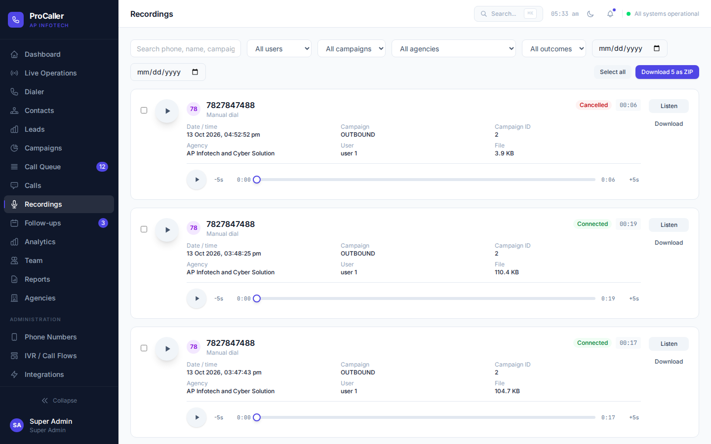

A user plays their own recordings. An agency plays its own line. Super Admin can filter every agency.

## 10. Reports

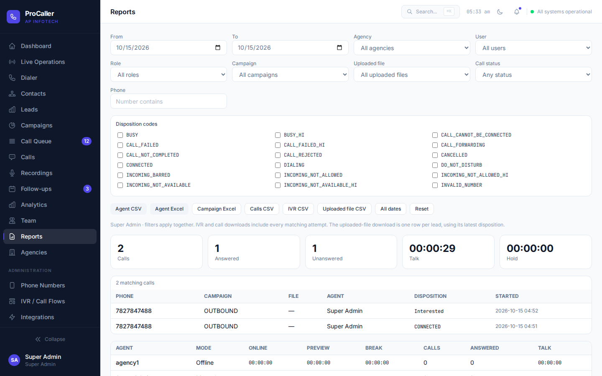

Filters combine: dates, agency, role, user, campaign, uploaded file, phone, call status, and disposition codes. Downloads use the same filters.

- **Agent CSV** / **Agent Excel** — online, preview, break, calls, and talk.
- **Campaign Excel** — results by campaign.
- **Calls CSV** — every matching attempt.
- **IVR CSV** — voice-campaign attempts. Hidden for a user.
- **Uploaded file CSV** — one row per lead. Never called is `NOT_DIALED`.

**All dates** clears the day limit. **Reset** returns to today. `CONNECTED` is stored only after the customer answered. A call still going out is `DIALING`. An unmatched network message is `UNKNOWN_UNCLASSIFIED`. The checkboxes are the full code list, including Hindi codes ending in `_HI`.

## 11. Team

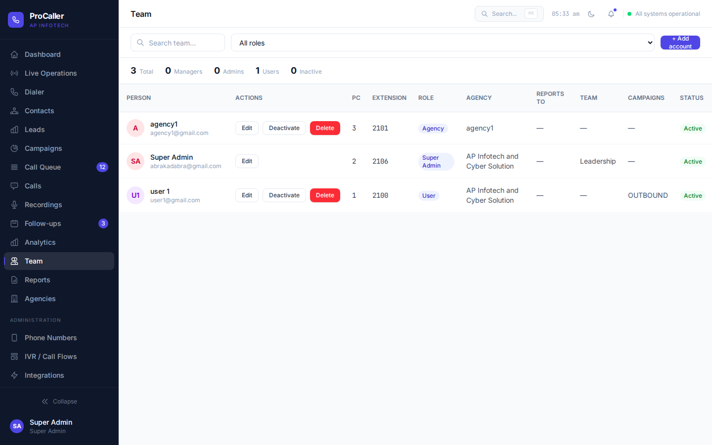

**Add account** creates a manager, admin, or user your role is allowed to create. An agency creates people only inside its own company, and a new user needs a campaign in that agency. PC number and extension stay fixed.

## 12. Agencies

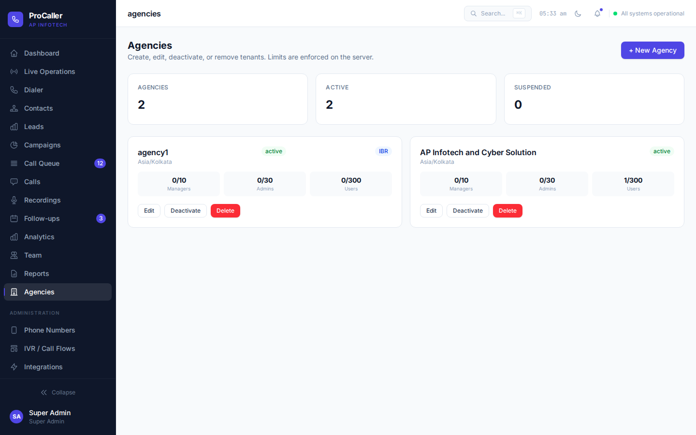

Super Admin uses **New Agency** to add a company and its manager, admin, and user limits. The IBR mark means that agency may run voice campaigns.

## 13. IVR voice campaigns

When IBR is on, a manager, agency, or admin approves a file on an IVR campaign. ProCaller builds one voice message per number from that row. The campaign thread count is how many of those calls run at once. When the customer answers, that number’s message plays and the line hangs up. Download the result with **IVR CSV**. The voice is English. Outcomes use the same disposition codes.

## 14. A normal day

1. Super Admin creates the agency and, when needed, turns on IBR.
2. The agency creates managers, admins, and users, each user on a campaign.
3. Staff upload the Excel file and set threads to match how many agents will sit in Preview Auto.
4. Agents sign in, allow the microphone, and work Preview Auto.
5. Supervisors watch Live Operations. Reports and the lead file show Not dialed, the IVR code, or Connected.

© 2026 AP Infotech and Cyber Solution. ProCaller.
